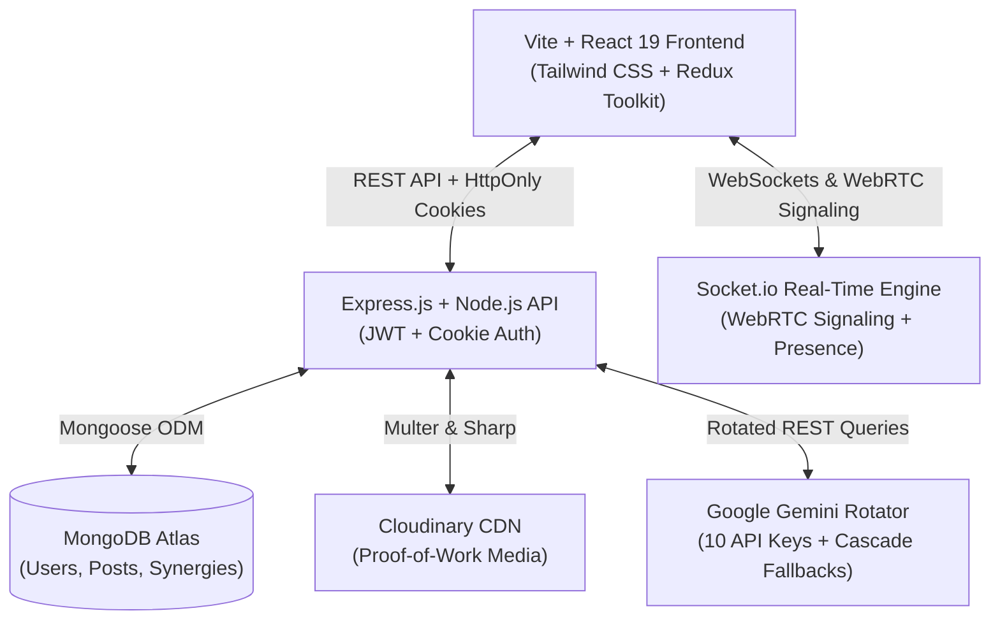

# ⚡ ZOCIAL — Career Intelligence Hub & Elite Developer Network

<div align="center">


[](https://react.dev/)
[](https://vitejs.dev/)
[](https://nodejs.org/)
[](https://expressjs.com/)
[](https://www.mongodb.com/)
[](https://socket.io/)
[](https://ai.google.dev/)
[](https://tailwindcss.com/)
[](https://opensource.org/licenses/MIT)

**Zocial** is a next-generation career intelligence platform and collaborative developer ecosystem. It bridges the gap between high-velocity proof-of-work social sharing, semantic AI talent scouting, real-time WebRTC pair collaboration, and automated ATS-optimized resume synthesis.

[Live Demo](https://zocial-2x3k.vercel.app/) • [Report Bug](https://github.com/siddhantsaxena45/Zocial/issues) • [Request Feature](https://github.com/siddhantsaxena45/Zocial/issues)

</div>

---

## 🌟 Key Highlights

- **🧠 Zocial Scout (AI Semantic Recruiter Portal)**: Match candidates directly against pasted Job Descriptions (JDs) using true AI semantic similarity scoring, evaluating authentic proof-of-work transmissions and technical skills over keyword stuffing.
- **📄 AI Automated Resume Synthesizer**: Converts real developer transmissions, project screenshots, and system architectures into ATS-compliant, executive resumes with one-click PDF export using Google Gemini.
- **🤝 Synergy Network Flow**: A professional connection system featuring outgoing/incoming request management, status tracking, and mutual collaboration unlocking.
- **💬 Real-Time Intelligence Messaging**: Socket.io-driven direct messaging with introductory rate limits to protect builders from unsolicited spam, unlocking unrestricted collaboration upon connecting.
- **📹 Gated WebRTC Peer-to-Peer Video Calling**: Secure video calls and pair-programming channels powered by Simple-Peer, restricted to verified connections with call-error fallbacks and call notifications.
- **🏷️ Unique `@handle` Identity Architecture**: Automatic generation of unique handles starting with `@` (e.g. `@swatisaxena`), keeping human-readable display names distinct and supporting Google OAuth 2.0 with instant synchronization.
- **🔒 Lifetime Persistent Browser Sessions**: Multi-year JWT sessions (`maxAge: 10 years`) with background `/user/me` authentication checks and infinite socket auto-reconnection for a seamless experience.

---

## 🚀 Core Features & Deep Dive

### 1. 🔍 Zocial Scout — Semantic Talent Scouting
- **JD Matching Engine**: Recruiters and engineering leads can paste raw Job Descriptions into Scout to evaluate candidate profiles.
- **ATS Match Score (%)**: Candidates are dynamically scored and ranked according to how closely their verified transmissions, target roles, and skill stacks align with the job requirements.
- **AI Semantic Explanations**: Provides contextual rationales for each match (e.g., *"Demonstrated capabilities in React, Tailwind, and Node.js architectures"*).
- **One-Click Direct Collaboration**: Instantly draft a personalized introduction to top candidates and open a real-time transmission channel.

### 2. 📝 Automated Gemini AI Resume Generator
- **Multi-Key Rotator Engine**: Robust rotating pool of up to 10 Gemini API keys (`GOOGLE_API_KEY1` through `GOOGLE_API_KEY10`) with automatic exponential backoff, key failover, and model cascading (`gemini-2.5-flash` → `gemini-3.8-flash` → `gemini-3.5-flash`).
- **Proof-of-Work Extraction**: Scans user posts, repository links, code snippets, and terminal logs to extract verified competencies.
- **ATS-Optimized Formatting**: Synthesizes executive summaries, key project achievements, and organized skill taxonomies.
- **One-Click PDF Export**: Clean, print-ready layout that exports directly to PDF.

### 3. 👥 Synergy Network & Collaborator Endorsements
- **Synergy Connection Requests**: Send, accept, decline, or withdraw professional collaboration requests.
- **Collaborator Tagging**: Tag co-developers on project posts with specialized roles (*e.g., Co-Developer, UI Designer, Backend Architect*).
- **Mutual Vouching**: Collaborators can formally vouch for project contributions, turning ordinary posts into verifiable portfolio assets.

### 4. 💬 Intelligence Hub & Gated Video Calling
- **Anti-Spam 1-Message Rule**: Builders can receive an introductory teaser message from unverified users; full messaging is unlocked once connected.
- **Presence Engine**: Real-time online/offline indicators and unread message counters.
- **Gated WebRTC Calling**: Video calling is restricted to verified connections to prevent harassment.
- **Missed Call Tracking**: Emits instant missed call alerts and notifications for incoming and outgoing connection requests.

### 5. 🛡️ Identity & Session Management
- **Automatic `@handle` Creation**: Users are assigned unique handles starting with `@` (e.g. `@swatisaxena`), while maintaining their full display name separately.
- **Dual Credential Sign-In**: Login seamlessly with either registered email address or `@username`.
- **Google OAuth 2.0**: Native One-Tap Google authentication with auto-healing for legacy accounts.
- **Persistent Sessions**: Browser sessions persist indefinitely until explicit logout or cookie clearing.

---

## 🛠️ Architecture & Tech Stack



### Frontend
- **Framework**: [React 19](https://react.dev/) with [Vite](https://vitejs.dev/)
- **State Management**: [Redux Toolkit](https://redux-toolkit.js.org/) + [Redux Persist](https://github.com/rt2zz/redux-persist)
- **Styling**: [Tailwind CSS 3.4](https://tailwindcss.com/), PostCSS, Custom Mesh Glassmorphism
- **Component Primitives**: [shadcn/ui](https://ui.shadcn.com/) via [Radix UI](https://www.radix-ui.com/)
- **Icons & Visuals**: [Lucide React](https://lucide.dev/)
- **Real-Time Client**: [Socket.io-client](https://socket.io/docs/v4/client-api/)
- **P2P Audio/Video**: [simple-peer](https://github.com/feross/simple-peer) (WebRTC)
- **Notifications**: [Sonner](https://sonner.emilkowal.ski/)

### Backend
- **Runtime**: [Node.js (v20+)](https://nodejs.org/) & [Express.js](https://expressjs.com/)
- **Database**: [MongoDB](https://www.mongodb.com/) via [Mongoose ODM](https://mongoosejs.com/)
- **Real-Time Gateway**: [Socket.io 4.8](https://socket.io/)
- **AI Processing**: Google Gemini Flash API with 10-Key Environment Rotator
- **Authentication**: `jsonwebtoken` (JWT), `bcryptjs`, `google-auth-library`
- **Asset Processing**: [Cloudinary SDK](https://cloudinary.com/), `multer`, `datauri`, `sharp`

---

## 📂 Project Structure

```
zocial/
├── backend/
│   ├── controllers/
│   │   ├── user.controller.js        # Authentication, handles, Scout AI search, synergy
│   │   ├── post.controller.js        # Proof-of-work transmissions, collaborator tagging
│   │   ├── message.controller.js     # Real-time messages & introductory rate limits
│   │   ├── resume.controller.js      # Gemini AI ATS Resume generation & PDF formatting
│   │   └── bounty.controller.js      # Collaborative project bounties
│   ├── middlewares/
│   │   ├── isAuthenticated.js        # JWT cookie authentication verification
│   │   └── multer.js                 # Memory storage file upload pipeline
│   ├── models/
│   │   ├── user.model.js             # User identity, name, @username, skills, portfolio
│   │   ├── post.model.js             # Transmissions, vouchers, collaborator tags
│   │   ├── conversation.model.js     # Chat participant records
│   │   ├── message.model.js          # Direct chat transmissions
│   │   ├── connectionRequest.model.js# Synergy LinkedIn-style requests
│   │   ├── notification.model.js     # System & engagement alerts
│   │   └── bounty.model.js           # Bounties & task commissions
│   ├── routes/                       # Express router definitions
│   ├── socket/
│   │   └── socket.js                 # WebRTC signaling, online tracking & call gates
│   ├── utils/
│   │   ├── geminiRotator.js          # 10-Key Gemini Rotator with cascade fallbacks
│   │   ├── cloudinary.js             # Cloudinary configuration
│   │   └── datauri.js                # Base64 data conversion utility
│   ├── index.js                      # Express application entry & CORS middleware
│   └── package.json
│
├── frontend/
│   ├── public/
│   ├── src/
│   │   ├── components/
│   │   │   ├── ChatPage.jsx          # Neural contact list & message hub
│   │   │   ├── ChatUser.jsx          # Conversation window, 1-msg gate, video call triggers
│   │   │   ├── GlobalCallManager.jsx # WebRTC P2P Video Call modal & signaling
│   │   │   ├── ZocialScout.jsx       # AI Recruiter JD matcher & ATS scoring portal
│   │   │   ├── ResumeGenerator.jsx   # Interactive AI Resume synthesis & PDF export
│   │   │   ├── SynergyRequests.jsx   # Incoming/Outgoing connection manager modal
│   │   │   ├── Profile.jsx           # Developer portfolio, transmissions & stats
│   │   │   ├── EditProfile.jsx       # Name, @handle, skills, and portfolio editor
│   │   │   ├── BountyHub.jsx         # Project bounties & freelance collaborations
│   │   │   ├── Signup.jsx            # Name input with automatic @handle generation
│   │   │   ├── Login.jsx             # Dual-credential email / @username authentication
│   │   │   ├── GoogleLoginButton.jsx # One-tap Google authentication
│   │   │   └── ui/                   # shadcn/ui components (Avatar, Dialog, Button, etc.)
│   │   ├── redux/                    # Redux Toolkit store and feature slices
│   │   ├── App.jsx                   # Global authentication bootstrap & socket listeners
│   │   └── main.jsx
│   └── package.json
└── README.md
```

---

## ⚙️ Environment Configuration

### Backend Setup (`backend/.env`)

```env
# Server Configuration
PORT=8000
NODE_ENV=development
FRONTEND_URL=http://localhost:5173

# Database & Security
MONGO_URI=mongodb+srv://<username>:<password>@cluster0.mongodb.net/zocial?retryWrites=true&w=majority
JWT_SECRET=your_super_secret_jwt_key_here

# Google OAuth 2.0
GOOGLE_CLIENT_ID=your_google_client_id.apps.googleusercontent.com

# Cloudinary Storage
CLOUDINARY_CLOUD_NAME=your_cloud_name
CLOUDINARY_API_KEY=your_api_key
CLOUDINARY_API_SECRET=your_api_secret

# Google Gemini Multi-Key Rotator (Add up to 10 keys for high throughput)
GEMINI_API_KEY=AIzaSy...
GOOGLE_API_KEY1=AIzaSy...
GOOGLE_API_KEY2=AIzaSy...
GOOGLE_API_KEY3=AIzaSy...
# GOOGLE_API_KEY4 ... GOOGLE_API_KEY10
```

### Frontend Setup (`frontend/.env`)

```env
VITE_API_URL=http://localhost:8000/api/v1
VITE_SOCKET_URL=http://localhost:8000
VITE_GOOGLE_CLIENT_ID=your_google_client_id.apps.googleusercontent.com
```

---

## 🏁 Getting Started

### Prerequisites

- [Node.js (v18 or v20+)](https://nodejs.org/)
- [MongoDB](https://www.mongodb.com/) (Local database or MongoDB Atlas cluster)
- [Cloudinary](https://cloudinary.com/) free tier account
- [Google AI Studio](https://aistudio.google.com/) Gemini API Key

### Installation

1. **Clone the repository:**
   ```bash
   git clone https://github.com/siddhantsaxena45/Zocial.git
   cd Zocial
   ```

2. **Install Backend Dependencies:**
   ```bash
   cd backend
   npm install
   ```

3. **Install Frontend Dependencies:**
   ```bash
   cd ../frontend
   npm install
   ```

### Running Locally

1. **Launch the Backend API & Socket Server:**
   ```bash
   cd backend
   npm run dev
   ```
   *The server will start on `http://localhost:8000`.*

2. **Launch the Frontend Vite Dev Server:**
   ```bash
   cd ../frontend
   npm run dev
   ```
   *Open `http://localhost:5173` in your browser.*

---

## 📡 API Reference

### 🔐 Authentication & Identity
| Method | Endpoint | Description |
|---|---|---|
| `POST` | `/api/v1/user/register` | Register new user with name & auto-unique `@handle` |
| `POST` | `/api/v1/user/login` | Login with password using email or `@username` |
| `POST` | `/api/v1/user/google-login` | Verify Google ID token & synchronize user handle |
| `GET` | `/api/v1/user/me` | Silent persistent session verification & handle auto-heal |
| `GET` | `/api/v1/user/logout` | Invalidate cookie & terminate session |

### 🤝 Synergy Network & Scouting
| Method | Endpoint | Description |
|---|---|---|
| `POST` | `/api/v1/user/scout` | AI Semantic candidate ranking against Job Descriptions |
| `GET` | `/api/v1/user/search` | Search users by name, `@username`, skills, or role |
| `POST` | `/api/v1/user/synergy/request/:id` | Send LinkedIn-style synergy connection request |
| `POST` | `/api/v1/user/synergy/accept/:requestId` | Accept incoming connection request |
| `POST` | `/api/v1/user/synergy/reject/:requestId` | Decline connection request |
| `DELETE` | `/api/v1/user/synergy/withdraw/:id` | Withdraw pending outgoing request |
| `DELETE` | `/api/v1/user/synergy/remove/:id` | Disconnect synergy with user |
| `GET` | `/api/v1/user/synergy/pending` | Fetch incoming & outgoing pending requests |

### 🤖 AI Resume Synthesis
| Method | Endpoint | Description |
|---|---|---|
| `POST` | `/api/v1/resume/generate` | Synthesize transmissions into an ATS-compliant JSON resume |
| `GET` | `/api/v1/resume/:userId` | Retrieve stored AI resume data for a builder |

### 💬 Messaging & Social Transmissions
| Method | Endpoint | Description |
|---|---|---|
| `GET` | `/api/v1/message/all/:id` | Fetch conversation history with 1-message limit check |
| `POST` | `/api/v1/message/send/:id` | Send direct message (blocks if 1-message unreplied limit is hit) |
| `POST` | `/api/v1/post/addpost` | Broadcast new technical transmission with image & code |
| `POST` | `/api/v1/post/vouch/:id` | Vouch/endorse a tagged collaborator on a transmission |

---

## 🔌 Socket.io Events

| Event Name | Type | Payload / Description |
|---|---|---|
| `getOnlineUsers` | Listen | Array of connected online user IDs |
| `newMessage` | Listen | Incoming real-time message object |
| `video-offer` | Emit/Listen | Initiates WebRTC signaling (gated by mutual connection check) |
| `video-answer` | Emit/Listen | Transmits SDP answer for P2P media negotiation |
| `new-ice-candidate` | Emit/Listen | Exchanges ICE candidates for NAT traversal |
| `call-ended` | Emit/Listen | Terminates video session and resets media streams |
| `call-error` | Listen | Emitted if video call is rejected due to lack of connection |

---

## 🔒 Security & Reliability

- **HttpOnly, Secure Cookies**: Authentication tokens are strictly isolated from client-side script access with `SameSite: None` in production.
- **Fail-Safe AI Rotator**: Built-in 10-key rotator prevents 429 quota exhaustion; if a Gemini model encounters high demand, the service falls back automatically to adjacent models in the fleet.
- **Rate-Limited DMs**: Prevents cold messaging spam by enforcing introductory limits until a synergy connection is accepted.
- **WebRTC Authorization**: Video call offers are cross-checked on the socket server before signaling packets are routed.

---

## 🤝 Contributing

Contributions, issues, and feature requests are welcome!

1. Fork the project repository.
2. Create your feature branch (`git checkout -b feature/AmazingFeature`).
3. Commit your changes (`git commit -m 'Add AmazingFeature'`).
4. Push to the branch (`git push origin feature/AmazingFeature`).
5. Open a Pull Request.

---

## 📄 License

Distributed under the MIT License. See `LICENSE` for details.

---

<div align="center">

Crafted with 💜 for engineers, builders, and recruiters.

**[Zocial Hub](https://zocial-2x3k.vercel.app/)**

</div>
