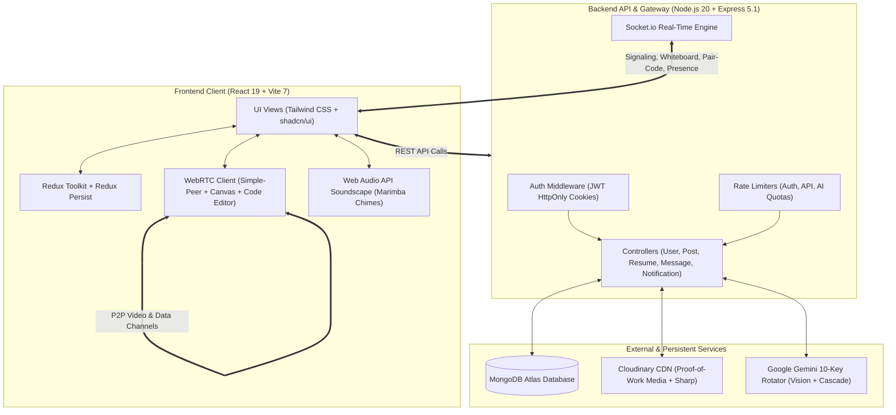

# ⚡ ZOCIAL — Career Intelligence Hub & Elite Developer Network

<div align="center">


[](https://react.dev/)
[](https://vitejs.dev/)
[](https://nodejs.org/)
[](https://expressjs.com/)
[](https://www.mongodb.com/)
[](https://socket.io/)
[](https://ai.google.dev/)
[](https://webrtc.org/)
[](https://tailwindcss.com/)
[](https://opensource.org/licenses/MIT)

**Zocial** is an AI-powered career intelligence platform and real-time collaborative developer network. It bridges the gap between high-velocity **proof-of-work transmissions**, **semantic AI talent scouting**, **multimodal vision resume synthesis**, and **real-time WebRTC pair collaboration with synchronized coding and whiteboarding**.

[Live Demo](https://zocial-2x3k.vercel.app/) • [Report Bug](https://github.com/siddhantsaxena45/Zocial/issues) • [Request Feature](https://github.com/siddhantsaxena45/Zocial/issues) • [Deployment Guide](DEPLOYMENT.md)

</div>

---

## 📑 Table of Contents

- [🌟 Architectural Highlights](#-architectural-highlights)
- [🚀 Core Systems & Deep Dive](#-core-systems--deep-dive)
  - [1. 🧠 Zocial Scout (AI Semantic Recruiter Portal)](#1--zocial-scout-ai-semantic-recruiter-portal)
  - [2. 🎯 AI Multimodal Job-Fit Simulator & Gap Auditor](#2--ai-multimodal-job-fit-simulator--gap-auditor)
  - [3. 📄 Multimodal Gemini Vision AI Resume Synthesizer](#3--multimodal-gemini-vision-ai-resume-synthesizer)
  - [4. 🤝 Synergy Network & Peer-Verified Endorsement Ledger](#4--synergy-network--peer-verified-endorsement-ledger)
  - [5. 📹 WebRTC Gated Video Calling, Pair-Coding & Whiteboard](#5--webrtc-gated-video-calling-pair-coding--whiteboard)
  - [6. 💬 Real-Time Messaging with Anti-Spam Gate](#6--real-time-messaging-with-anti-spam-gate)
  - [7. 🛡️ Identity, Session & Unique `@handle` Architecture](#7--identity-session--unique-handle-architecture)
  - [8. 🔄 10-Key Gemini Multi-Model Cascade & Failover Engine](#8--10-key-gemini-multi-model-cascade--failover-engine)
- [🛠️ Architecture & Data Flow](#️-architecture--data-flow)
- [💻 Tech Stack](#-tech-stack)
- [📂 Project Structure](#-project-structure)
- [⚙️ Environment Configuration](#️-environment-configuration)
- [🏁 Getting Started Locally](#-getting-started-locally)
- [🐳 Docker & Containerized Orchestration](#-docker--containerized-orchestration)
- [☁️ Production Deployment Blueprint](#️-production-deployment-blueprint)
- [📡 Comprehensive REST API Reference](#-comprehensive-rest-api-reference)
- [🔌 Socket.io Events Reference](#-socketio-events-reference)
- [🔒 Security & Reliability Hardening](#-security--reliability-hardening)
- [🤝 Contributing & License](#-contributing--license)

---

## 🌟 Architectural Highlights

- **🧠 Zocial Scout (AI Recruiter Portal)**: Match candidates directly against pasted Job Descriptions (JDs) using true AI semantic similarity scoring, evaluating verified proof-of-work transmissions and technical skills over resume keyword stuffing.
- **🎯 AI Multimodal Job-Fit Scanner**: Audits candidate project screenshots (UI architectures, system diagrams, terminal proofs) against any target job requirements to generate ATS match scores, identified skill gaps, custom elevator pitches, and tailored interview prep questions.
- **📄 Multimodal Gemini Vision Resume Synthesizer**: Converts developer transmissions, UI designs, and system architectures into ATS-compliant, executive resumes with one-click print-ready PDF export.
- **🤝 Peer-Vouched Synergy Network**: LinkedIn-style connection flow with mutual collaborator tagging and cryptographic-style peer verification badges.
- **📹 Gated WebRTC Collaboration Suite**: Peer-to-peer video calls gated by connection status, featuring a **Web Audio API marimba ringtone engine**, **real-time synchronized Pair-Programming editor**, and **collaborative canvas whiteboard**.
- **💬 Anti-Spam Direct Messaging**: 1-message unreplied teaser gate protecting builders from cold spam until mutual connection is confirmed.
- **🏷️ Unique `@handle` Identity System**: Guaranteed unique `@username` creation from display name or email, dual-credential authentication, Google OAuth 2.0 with legacy account auto-healing, and 10-year persistent sessions.
- **🔄 High-Throughput 10-Key Gemini Rotator**: Automated round-robin rotation across up to 10 API keys with cascading fallbacks across 6 Gemini models (`gemini-2.5-flash` ➔ `gemini-3.8-flash` ➔ `gemini-3.5-flash` ➔ `gemini-3.5-flash-lite` ➔ `gemini-3.6-flash` ➔ `gemini-3.1-flash-lite`).

---

## 🚀 Core Systems & Deep Dive

### 1. 🧠 Zocial Scout (AI Semantic Recruiter Portal)
- **Direct JD Ingestion**: Recruiters and engineering leads paste raw Job Descriptions or select built-in presets (*Full-Stack React & Node, Python & Cloud Architect, AI & Full-Stack Builder*).
- **Semantic Candidate Matching**: Evaluates user bios, claimed skills, target titles, and verified project transmissions to compute a dynamic **ATS Match Score (%)**.
- **Semantic Rationales**: Generates contextual explanations detailing why a candidate aligns with the role.
- **One-Click Collaborative Intro**: Automatically populates personalized outreach messages into direct messages with target builders.

### 2. 🎯 AI Multimodal Job-Fit Simulator & Gap Auditor
- **Visual Proof-of-Work Verification**: Transmits up to 3 project screenshots (UI dashboards, cloud topology diagrams, terminal logs) to Gemini Vision.
- **Match Tier Classification**: Classifies candidate fit as *Strong Match*, *Moderate Match*, or *Developing Match*.
- **Gap & Evidence Audit**: Detects missing skills against the JD and highlights visually confirmed technical capabilities.
- **Strategic Preparation**: Synthesizes a tailored 2-sentence elevator pitch and generates technical interview questions based on the candidate's exact stack.

### 3. 📄 Multimodal Gemini Vision AI Resume Synthesizer
- **Visual Artifact Extraction**: Inspects up to 5 project transmissions with Cloudinary-optimized visual assets (component design polish, database schema ER diagrams, passed CI/CD pipelines).
- **ATS-Optimized Formatting**: Synthesizes an executive career summary, domain focus tags, and technical competencies with animated visual proficiency indicators.
- **Vision Verified Badge**: Highlights how many visual proof-of-work artifacts were independently audited by Gemini.
- **Print-Ready PDF Export**: Formatted with standard A4 print stylesheets (`@media print`) for clean, single-click PDF generation without watermarks or formatting errors.

### 4. 🤝 Synergy Network & Peer-Verified Endorsement Ledger
- **Synergy Connection Flow**: Send, accept, decline, or withdraw professional connection requests with real-time status badges (*Sync Profile*, *Pending*, *Accepted*).
- **Collaborator Tagging**: Authors tag co-developers on technical transmissions with explicit roles (*Co-Developer, UI Designer, Backend Architect, System Lead*).
- **Two-Way Vouching**: Tagged collaborators receive notifications to formally vouch for contributions, unlocking the prestigious **Peer-Verified Synergy** badge on project posts.
- **Network Explorer Dialog**: Inspect follower lists, following connections, and mutual collaborators in modal views.

### 5. 📹 WebRTC Gated Video Calling, Pair-Coding & Whiteboard
- **Authorization Gate**: Socket signaling server verifies mutual synergy before routing video offers, preventing unsolicited calls.
- **Synthesized Web Audio Soundscape**:
  - *Incoming Ringtone*: Melodic, soothing pentatonic marimba chime (D5 ➔ F#5 ➔ A5 ➔ D6).
  - *Call Connected*: Bright ascending two-tone confirmation chime (E5 ➔ B5).
  - *Call Ended / Disconnected*: Soft descending termination chime (A4 ➔ E4).
- **3-in-1 Real-Time Collaboration Modes**:
  - **Video Call Mode**: Peer-to-peer video streaming with microphone mute, camera toggle, and front/back mobile camera flipping.
  - **Pair-Programming Mode**: Synchronized code editor with language syntax selection (JavaScript, Python, C++, TypeScript, HTML/CSS), real-time cursor/keystroke broadcasts, and instant code copying.
  - **Collaborative Whiteboard**: Synchronized HTML5 canvas with custom brush colors, sizing, eraser, and synchronized canvas clearing.
- **Missed Call Persistence**: Emits system alerts and records persistent missed call notifications if a recipient is away.

### 6. 💬 Real-Time Messaging with Anti-Spam Gate
- **Anti-Spam 1-Message Rule**: Unconnected builders can transmit only a single introductory teaser message; subsequent messaging is blocked until the recipient replies or accepts a synergy connection.
- **Presence Engine**: Real-time online/offline indicators and unread notification badges.
- **Persistent Message Histories**: MongoDB-backed conversations with instant Socket.io delivery.

### 7. 🛡️ Identity, Session & Unique `@handle` Architecture
- **Automatic `@handle` Creation**: Automatically derives unique, URL-safe handles prefixed with `@` (e.g. `@swatisaxena`, `@builder204`) while keeping human display names distinct.
- **Dual-Credential Sign-In**: Login seamlessly using either registered email or `@username`.
- **Google OAuth 2.0**: Native Google One-Tap authentication with automatic account provisioning and legacy profile auto-healing.
- **Lifetime Persistent Browser Sessions**: Multi-year JWT sessions (`maxAge: 3650 days`) stored in HttpOnly cookies with silent `/user/me` verification on load.

### 8. 🔄 10-Key Gemini Multi-Model Cascade & Failover Engine
- **Rotating Key Pool**: Reads `GOOGLE_API_KEY1` through `GOOGLE_API_KEY10` (or `GEMINI_API_KEY1`..`10`) from environment variables.
- **Automatic Failover Cascade**: Seamlessly transitions queries across 6 models upon encountering HTTP 429 quota exhaustion or model unavailability:
  ```
  gemini-2.5-flash ➔ gemini-3.8-flash ➔ gemini-3.5-flash ➔ gemini-3.5-flash-lite ➔ gemini-3.6-flash ➔ gemini-3.1-flash-lite
  ```
- **Image Optimizer**: Automatically converts Cloudinary media to `/upload/w_800,c_limit,q_auto,f_jpg/` before base64 encoding to minimize network latency.

---

## 🛠️ Architecture & Data Flow



---

## 💻 Tech Stack

### Frontend
- **Core**: [React 19.1](https://react.dev/), [Vite 7.0](https://vitejs.dev/)
- **Routing**: [React Router DOM v7](https://reactrouter.com/)
- **State Management**: [Redux Toolkit](https://redux-toolkit.js.org/), [Redux Persist](https://github.com/rt2zz/redux-persist)
- **Styling**: [Tailwind CSS 3.4](https://tailwindcss.com/), [PostCSS](https://postcss.org/), [tailwindcss-animate](https://github.com/jamiebuilds/tailwindcss-animate)
- **UI Primitives**: [shadcn/ui](https://ui.shadcn.com/) based on [Radix UI](https://www.radix-ui.com/)
- **Real-Time Client**: [Socket.io-client 4.8](https://socket.io/docs/v4/client-api/)
- **WebRTC P2P**: [simple-peer 9.11](https://github.com/feross/simple-peer)
- **Authentication**: [@react-oauth/google](https://www.npmjs.com/package/@react-oauth/google)
- **Icons**: [Lucide React](https://lucide.dev/), [React Icons](https://react-icons.github.io/react-icons/)
- **Charts & Metrics**: [Recharts 2.15](https://recharts.org/)
- **Feedback & Notifications**: [Sonner](https://sonner.emilkowal.ski/)

### Backend
- **Runtime**: [Node.js (v20+)](https://nodejs.org/)
- **Server Framework**: [Express.js 5.1](https://expressjs.com/)
- **Database**: [MongoDB Atlas](https://www.mongodb.com/atlas) with [Mongoose ODM 8.16](https://mongoosejs.com/)
- **Real-Time Gateway**: [Socket.io 4.8](https://socket.io/)
- **Security & Hardening**: [Helmet 8.3](https://helmetjs.github.io/), [express-rate-limit 8.7](https://www.npmjs.com/package/express-rate-limit), [cookie-parser](https://www.npmjs.com/package/cookie-parser), [cors](https://www.npmjs.com/package/cors)
- **Authentication**: [jsonwebtoken 9.0](https://www.npmjs.com/package/jsonwebtoken), [bcryptjs 3.0](https://www.npmjs.com/package/bcryptjs), [google-auth-library 10.1](https://www.npmjs.com/package/google-auth-library)
- **Media Processing**: [Cloudinary SDK 2.7](https://cloudinary.com/), [multer 2.0](https://www.npmjs.com/package/multer), [sharp 0.34](https://sharp.pixelplumbing.com/), [datauri](https://www.npmjs.com/package/datauri)
- **AI Processing**: Google Gemini Flash API with 10-key rotating pool and model cascade

---

## 📂 Project Structure

```
zocial/
├── .github/                      # Workflows & CI automation
├── backend/                      # Express 5.1 + Socket.io Server
│   ├── controllers/
│   │   ├── message.controller.js       # Real-time messages & anti-spam rate limiter
│   │   ├── notification.controller.js  # Notifications, read status & missed calls
│   │   ├── post.controller.js          # Transmissions, code snippets, vouching, bookmarks
│   │   ├── resume.controller.js        # Multimodal Gemini AI resume & Job-Fit simulator
│   │   └── user.controller.js          # Auth, handles, Scout semantic search, synergy
│   ├── middlewares/
│   │   ├── isAuthenticated.js          # JWT cookie verification middleware
│   │   └── multer.js                   # Memory storage media upload pipeline
│   ├── models/
│   │   ├── comment.model.js            # Post discussion comments
│   │   ├── connectionRequest.model.js  # LinkedIn-style synergy connection records
│   │   ├── conversation.model.js       # Chat room participant index
│   │   ├── message.model.js            # Direct transmissions and payloads
│   │   ├── notification.model.js       # Engagement, synergy & missed call alerts
│   │   ├── post.model.js               # Transmissions, code snippets, collaborator tags
│   │   └── user.model.js               # Profiles, @handles, skills, resume data
│   ├── routes/
│   │   ├── message.route.js            # Direct messaging endpoints
│   │   ├── notification.route.js       # Notification feed endpoints
│   │   ├── post.route.js               # Transmission publication & engagement routes
│   │   ├── resume.route.js             # AI resume & Job-Fit simulation routes
│   │   └── user.route.js               # Authentication, handles, synergy & Scout
│   ├── socket/
│   │   └── socket.js                   # WebRTC signaling, Pair-Code & Whiteboard sync
│   ├── utils/
│   │   ├── cloudinary.js               # Cloudinary CDN credentials config
│   │   ├── datauri.js                  # Buffer-to-base64 parser
│   │   ├── db.js                       # MongoDB Atlas Mongoose connection
│   │   └── geminiRotator.js            # 10-Key Gemini Rotator with model cascade
│   ├── Dockerfile                      # Container definition for backend service
│   ├── index.js                        # Express server entry point & security headers
│   └── package.json
│
├── frontend/                     # React 19 + Vite 7 Client
│   ├── public/                         # Static assets
│   ├── src/
│   │   ├── components/
│   │   │   ├── ui/                     # shadcn/ui components (Avatar, Dialog, Button, etc.)
│   │   │   ├── BountyHub.jsx           # Task commissions & bounty hub
│   │   │   ├── ChatPage.jsx            # Messaging layout & contact selector
│   │   │   ├── ChatUser.jsx            # Active conversation, 1-msg teaser gate, call button
│   │   │   ├── CommentDialog.jsx       # Modal for full transmission discussion
│   │   │   ├── CreatePost.jsx          # Transmission modal (Images, Code, Sandbox, Collab)
│   │   │   ├── EditProfile.jsx         # Profile, @handle, bio, skills & link editor
│   │   │   ├── GlobalCallManager.jsx   # WebRTC Video, Pair-Code & Whiteboard modal
│   │   │   ├── GoogleLoginButton.jsx   # Google One-Tap authentication button
│   │   │   ├── JobFitModal.jsx         # Gemini Vision Job-Fit Scanner modal
│   │   │   ├── LeftSidebar.jsx         # Desktop & mobile responsive navigation
│   │   │   ├── LikesDialog.jsx         # Engagement ledger inspection modal
│   │   │   ├── Login.jsx               # Dual-credential email / @username authentication
│   │   │   ├── NetworkListDialog.jsx   # Synergy connections & followers viewer
│   │   │   ├── NotificationPop.jsx     # Dropdown notification center
│   │   │   ├── Post.jsx                # Transmission card with code inspector & sandbox
│   │   │   ├── Profile.jsx             # Developer portfolio, stats, and transmissions
│   │   │   ├── ResumeGenerator.jsx     # ATS resume view, Vision badges & PDF export
│   │   │   ├── SearchDialog.jsx        # Real-time search dialog for builders & stacks
│   │   │   ├── Signup.jsx              # Registration with unique @handle generator
│   │   │   ├── SynergyRequests.jsx     # Connection requests manager modal
│   │   │   └── ZocialScout.jsx         # AI Recruiter JD matcher & ATS candidate portal
│   │   ├── hooks/                      # Custom React hooks (Data fetching & auth sync)
│   │   ├── redux/                      # Redux Toolkit slices (auth, call, post, rtn, socket)
│   │   ├── App.jsx                     # Router config, global auth refresh & socket setup
│   │   ├── index.css                   # Tailwind styles, glassmorphism, print CSS
│   │   └── main.jsx                    # Vite entry point
│   ├── Dockerfile.frontend             # Container definition with Nginx web server
│   ├── nginx.conf                      # Nginx reverse proxy configuration
│   ├── package.json
│   ├── tailwind.config.js
│   ├── vercel.json                     # Vercel deployment & SPA routing rules
│   └── vite.config.js
│
├── docker-compose.yml            # Multi-container orchestration (Backend + Frontend)
├── DEPLOYMENT.md                 # Complete free-tier deployment guide (Render + Vercel)
└── README.md
```

---

## ⚙️ Environment Configuration

### Backend Configuration (`backend/.env`)

```env
# Server
PORT=8000
NODE_ENV=development
CLIENT_URL=http://localhost:5173

# Database & Security
MONGO_URI=mongodb+srv://<username>:<password>@cluster0.mongodb.net/zocial?retryWrites=true&w=majority
JWT_SECRET=your_super_secret_jwt_key_here

# Google OAuth 2.0
GOOGLE_CLIENT_ID=your_google_client_id.apps.googleusercontent.com
GOOGLE_CLIENT_SECRET=your_google_client_secret

# Cloudinary CDN Storage
CLOUDINARY_CLOUD_NAME=your_cloud_name
CLOUDINARY_API_KEY=your_cloudinary_api_key
CLOUDINARY_API_SECRET=your_cloudinary_api_secret

# Google Gemini Multi-Key Rotator (Configure up to 10 keys for high throughput)
GEMINI_API_KEY=AIzaSy...
GOOGLE_API_KEY1=AIzaSy...
GOOGLE_API_KEY2=AIzaSy...
GOOGLE_API_KEY3=AIzaSy...
# GOOGLE_API_KEY4 ... GOOGLE_API_KEY10
```

### Frontend Configuration (`frontend/.env`)

```env
VITE_API_URL=http://localhost:8000/api/v1
VITE_SOCKET_URL=http://localhost:8000
VITE_GOOGLE_CLIENT_ID=your_google_client_id.apps.googleusercontent.com
```

---

## 🏁 Getting Started Locally

### Prerequisites

- [Node.js (v20+)](https://nodejs.org/)
- [npm](https://www.npmjs.com/) or [yarn](https://yarnpkg.com/)
- [MongoDB Atlas](https://www.mongodb.com/atlas) cluster or local MongoDB instance
- [Cloudinary](https://cloudinary.com/) account (Free tier)
- [Google AI Studio](https://aistudio.google.com/) Gemini API Key

### Installation

1. **Clone the repository:**
   ```bash
   git clone https://github.com/siddhantsaxena45/Zocial.git
   cd Zocial
   ```

2. **Install Backend Dependencies:**
   ```bash
   cd backend
   npm install
   ```

3. **Install Frontend Dependencies:**
   ```bash
   cd ../frontend
   npm install
   ```

### Running the Development Environment

1. **Launch the Backend API & Socket Server:**
   ```bash
   cd backend
   npm run dev
   ```
   *The backend will initialize on `http://localhost:8000`.*

2. **Launch the Frontend Client:**
   ```bash
   cd ../frontend
   npm run dev
   ```
   *The client will start on `http://localhost:5173`.*

---

## 🐳 Docker & Containerized Orchestration

Run the entire Zocial stack in isolated containers with a single command:

```bash
docker-compose up --build
```

- **Backend Container**: Runs on port `8000`.
- **Frontend Container**: Served via Nginx on port `5173`.
- **Network**: Joined through the shared bridge network `zocial-network`.

To run containers in detached mode:
```bash
docker-compose up -d
```

To stop and remove containers:
```bash
docker-compose down
```

---

## ☁️ Production Deployment Blueprint

Deploy Zocial for **100% Free** using **Render** for the Backend and **Vercel** for the Frontend. Refer to [DEPLOYMENT.md](DEPLOYMENT.md) for detailed step-by-step instructions.

```
+-------------------------------------------------------+
|  Vercel (Frontend Client)                             |
|  - Framework Preset: Vite                             |
|  - Root Directory: frontend                           |
|  - Env: VITE_API_URL, VITE_SOCKET_URL                 |
+---------------------------+---------------------------+
                            |
           REST API + WebSockets / WebRTC Signaling
                            |
+---------------------------v---------------------------+
|  Render (Backend Web Service)                         |
|  - Environment: Docker (Root Dockerfile)              |
|  - Env: PORT, MONGO_URI, JWT_SECRET, CLIENT_URL,      |
|         CLOUDINARY_*, GOOGLE_API_KEY1..10             |
+-------------------------------------------------------+
```

1. **Deploy Backend to Render**: Create a Docker Web Service pointing to the root `Dockerfile` and set all required environment variables.
2. **Deploy Frontend to Vercel**: Import repository with `frontend` as the Root Directory and set `VITE_API_URL` to your Render URL.
3. **Synchronize CORS**: Set `CLIENT_URL` on Render to your production Vercel domain.

---

## 📡 Comprehensive REST API Reference

### 🔐 Authentication & Profile Management
| Method | Endpoint | Description | Auth Required |
|---|---|---|:---:|
| `POST` | `/api/v1/user/register` | Register new user with display name & auto-generated unique `@handle` | No |
| `POST` | `/api/v1/user/login` | Authenticate with password using email or `@username` | No |
| `POST` | `/api/v1/user/google-login` | Authenticate via Google ID token with auto-provisioning | No |
| `GET` | `/api/v1/user/me` | Silent persistent session check & handle auto-heal | Yes |
| `GET` | `/api/v1/user/logout` | Invalidate session cookies | Yes |
| `POST` | `/api/v1/user/forgot-password` | Request password reset token | No |
| `POST` | `/api/v1/user/reset-password` | Reset password using valid crypto token | No |
| `GET` | `/api/v1/user/:id/profile` | Retrieve complete developer portfolio profile | Yes |
| `POST` | `/api/v1/user/profile/edit` | Update display name, bio, skills, target role, and avatar | Yes |

### 🤝 Synergy Network & Scouting
| Method | Endpoint | Description | Auth Required |
|---|---|---|:---:|
| `POST` | `/api/v1/user/scout` | AI Semantic candidate ranking against Job Descriptions | Yes |
| `GET` | `/api/v1/user/search` | Search users by name, `@username`, skills, or target role | Yes |
| `POST` | `/api/v1/user/synergy/request/:id` | Send a synergy connection request | Yes |
| `POST` | `/api/v1/user/synergy/accept/:requestId` | Accept incoming synergy connection request | Yes |
| `POST` | `/api/v1/user/synergy/reject/:requestId` | Decline synergy connection request | Yes |
| `DELETE` | `/api/v1/user/synergy/withdraw/:id` | Withdraw a pending outgoing request | Yes |
| `DELETE` | `/api/v1/user/synergy/remove/:id` | Disconnect mutual synergy | Yes |
| `GET` | `/api/v1/user/synergy/pending` | Fetch list of incoming and outgoing pending requests | Yes |
| `GET` | `/api/v1/user/synergy/status/:id` | Check relationship status with target user | Yes |
| `GET` | `/api/v1/user/suggested` | Retrieve algorithmically suggested developers | Yes |

### 📄 AI Resume Synthesis & Job-Fit Simulator
| Method | Endpoint | Description | Auth Required |
|---|---|---|:---:|
| `POST` | `/api/v1/resume/generate` | Synthesize transmissions and visual artifacts into an ATS resume | Yes |
| `POST` | `/api/v1/resume/generate/:id` | Generate or regenerate resume for specified builder | Yes |
| `GET` | `/api/v1/resume/:id` | Retrieve synthesized resume JSON data | Yes |
| `POST` | `/api/v1/resume/job-fit` | Audit profile and visual artifacts against a target Job Description | Yes |

### 📢 Proof-of-Work Transmissions & Collaborations
| Method | Endpoint | Description | Auth Required |
|---|---|---|:---:|
| `POST` | `/api/v1/post/addpost` | Broadcast technical transmission with image, code & sandbox | Yes |
| `GET` | `/api/v1/post/all` | Fetch chronological feed of all transmissions | Yes |
| `GET` | `/api/v1/post/userpost/all` | Fetch current user's transmissions | Yes |
| `PUT` | `/api/v1/post/edit/:id` | Edit transmission caption | Yes |
| `DELETE` | `/api/v1/post/delete/:id` | Delete transmission | Yes |
| `GET` | `/api/v1/post/:id/like` | Like a transmission | Yes |
| `GET` | `/api/v1/post/:id/dislike` | Unlike a transmission | Yes |
| `POST` | `/api/v1/post/:id/vouch` | Endorse or decline tagged collaboration on a transmission | Yes |
| `POST` | `/api/v1/post/:id/comment` | Add discussion comment | Yes |
| `GET` | `/api/v1/post/:id/comment/all` | Get all comments for a transmission | Yes |
| `DELETE` | `/api/v1/post/comment/:id` | Remove a comment | Yes |
| `GET` | `/api/v1/post/:id/bookmark` | Toggle transmission bookmark | Yes |

### 💬 Messaging & Notifications
| Method | Endpoint | Description | Auth Required |
|---|---|---|:---:|
| `GET` | `/api/v1/message/all/:id` | Fetch conversation history (enforces anti-spam gate) | Yes |
| `POST` | `/api/v1/message/send/:id` | Send direct message (blocks if unreplied teaser limit is hit) | Yes |
| `GET` | `/api/v1/notification` | Fetch user notification feed | Yes |
| `POST` | `/api/v1/notification/mark-read` | Mark all notifications as seen | Yes |
| `POST` | `/api/v1/notification/missed-call/:id` | Log persistent missed video call alert | Yes |
| `GET` | `/api/v1/ping` | Health check endpoint | No |

---

## 🔌 Socket.io Events Reference

### Connection & Presence
| Event | Direction | Payload | Description |
|---|:---:|---|---|
| `connection` | Client ➔ Server | `query: { userId }` | Authenticates client socket connection |
| `getOnlineUsers` | Server ➔ Client | `string[]` | Array of currently connected online user IDs |
| `disconnect` | Client ➔ Server | — | Removes socket from user pool and updates presence |

### Messaging & Notifications
| Event | Direction | Payload | Description |
|---|:---:|---|---|
| `newMessage` | Server ➔ Client | `Message` object | Delivers direct chat message in real time |
| `notification` | Server ➔ Client | `Notification` object | Emits like, comment, synergy, or missed call alert |

### WebRTC Video Signaling (Synergy-Gated)
| Event | Direction | Payload | Description |
|---|:---:|---|---|
| `video-offer` | Both | `{ to, offer, userDetails }` | Initiates WebRTC call (gated by mutual connection check) |
| `video-answer` | Both | `{ to, answer }` | Transmits SDP answer for peer connection negotiation |
| `ice-candidate` | Both | `{ to, candidate }` | Exchanges ICE candidate for NAT traversal |
| `call-rejected` | Both | `{ to }` | Signals call decline to initiator |
| `call-ended` | Both | `{ to }` | Terminates active call and tears down peer streams |
| `call-error` | Server ➔ Client | `{ message }` | Emitted when call is blocked due to lack of synergy |
| `missed-call` | Client ➔ Server | `{ to }` | Emits missed call notification if recipient does not pick up |

### Real-Time Pair Programming & Whiteboard
| Event | Direction | Payload | Description |
|---|:---:|---|---|
| `call_mode_change` | Client ➔ Server | `{ to, mode }` | Syncs view mode across peers (`video`, `pair_code`, `whiteboard`) |
| `pair_code_change` | Client ➔ Server | `{ to, code, language, cursor }` | Broadcasts live code editor changes to call partner |
| `pair_code_update` | Server ➔ Client | `{ from, code, language, cursor }` | Delivers synchronized code updates to call partner |
| `whiteboard_draw` | Client ➔ Server | `{ to, drawData }` | Broadcasts canvas drawing strokes |
| `whiteboard_draw_update` | Server ➔ Client | `{ from, drawData }` | Renders remote drawing strokes on partner's canvas |
| `whiteboard_clear` | Client ➔ Server | `{ to }` | Requests canvas clear for both peers |
| `whiteboard_cleared` | Server ➔ Client | `{ from }` | Wipes canvas on remote peer's screen |

---

## 🔒 Security & Reliability Hardening

1. **HttpOnly, SameSite Cookies**: Authentication tokens are strictly isolated from client-side script access, mitigating XSS token harvesting.
2. **Reverse Proxy Trust**: Configured with `app.set("trust proxy", 1)` to accurately enforce rate limits across cloud proxies (Render, Vercel).
3. **Multi-Tiered Rate Limiting**:
   - *General API Limiter*: 300 requests per 15 minutes.
   - *Brute-Force Auth Limiter*: 20 requests per 15 minutes on login, registration, and password recovery.
   - *AI Quota Protection*: 10 requests per 10 minutes on Gemini resume generation and Job-Fit simulation endpoints.
4. **Denial-of-Service Defense**: Request bodies are restricted to `50kb` to prevent memory exhaustion attacks.
5. **Fail-Safe AI Rotator**: 10-key pool with automatic exponential backoff prevents service disruptions from Google AI Studio rate limits.
6. **WebRTC Authorization Gates**: Peer-to-peer media signaling is strictly authorized on the server to prevent unsolicited calls.
7. **Clean Production Errors**: Production error handler suppresses raw stack traces to prevent sensitive system disclosures.

---

## 🤝 Contributing & License

Contributions, bug reports, and suggestions are welcome!

1. Fork the repository.
2. Create your feature branch (`git checkout -b feature/AmazingFeature`).
3. Commit your changes (`git commit -m 'feat: Add AmazingFeature'`).
4. Push to the branch (`git push origin feature/AmazingFeature`).
5. Open a Pull Request.

Distributed under the **MIT License**. See `LICENSE` for details.

---

<div align="center">

Crafted with 💜 for engineers, builders, and recruiters.

**[Explore Zocial Live](https://zocial-2x3k.vercel.app/)**

</div>
